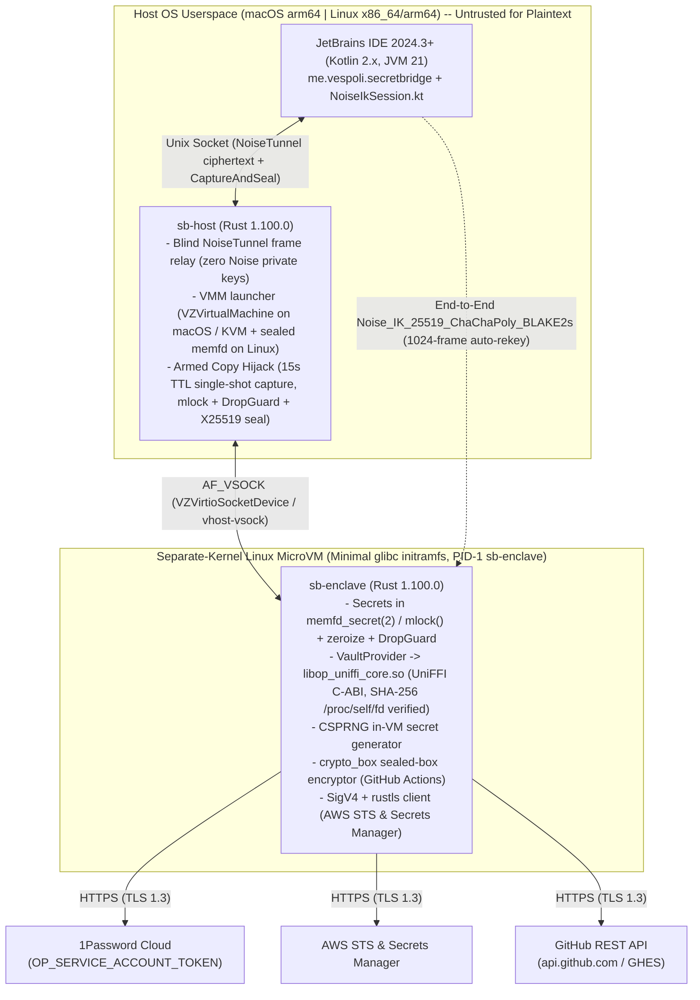

# SecretBridge for 1Password -- Architecture & Completion Proposal

- **Status:** Implemented & verified (Phases 0-5 complete)
- **Owner / Vendor:** Anthony Vespoli (`me.vespoli.secretbridge` / `susanbeasles/secretbridge`)
- **Base commit reviewed:** `5dcdc1d` (`main`)

---

## 1. Current Repository Baseline & Audit Summary

### 1.1 Inventory of `main` (`5dcdc1d`)

| Component | Current State | Assessment |
|---|---|---|
| `backend/secretbridge.py` (680 lines) + `backend/requirements.txt` | Byte-identical to resources inside `secretbridge/lib/secretbridge-0.1.0.jar` (`sha256: 3a1a5637...`) | Legacy Python CLI wrapper around `op` + `gh` + `boto3` + `PyNaCl`; removed and superseded by the Rust microVM enclave architecture below |
| `secretbridge/lib/secretbridge-0.1.0.jar` + `secretbridge-0.1.0.zip` | Compiled Java 21 bytecode (classfile v65, 10 classes under `me.vespoli.secretbridge.*`), **no Java/Kotlin source in repo** | Removed and replaced by full Kotlin 2.x + Gradle 9.3.0 source in `plugin/` |
| Build & test harness | Only `scripts/package-backend.py` (JAR resource swapper); zero unit/integration tests; no Gradle or Cargo | Replaced by root `Makefile` `check:` target running Cargo fmt/clippy/test + guard tests + Gradle JUnit & plugin build |
| CI (`.github/workflows/agent-guard.yml`) | Validates `.agent-guard` syntax, hidden Unicode markers, and `gitleaks` | Protected by guardrails; recommended Rust + Gradle + Plugin Verifier CI YAML provided for owner to apply |

### 1.2 Security Flaws Identified in v0.1.0 (Must Never Regress in v2)

| ID | Severity | v0.1.0 Flaw | How v2 Eliminates It |
|---|---|---|---|
| **S1** | **HIGH** | Repo-controlled `secretbridge.json` `tools.{op,gh,...}` (and RPC `bootstrap`) allowed arbitrary host binary execution upon opening an untrusted repo; `PATH` fallback allowed hijacking | **Eliminated structurally:** zero host CLI execution (`op`, `gh`, `aws`, `python` all removed). `secretbridge.json` holds strictly schema-validated vault/env/binding metadata -- `tools` key is rejected |
| **S2** | **MED-HIGH** | Unescaped repo/org/environment segments interpolated into GitHub API paths without `re.ASCII`, enabling `..`, `/`, `?`, `#` path/query traversal | Validated Rust newtypes (`AsciiIdent`, `GitHubOwner`, `GitHubRepo`, `GitHubEnvName`) + percent-encoded URL path segment builders |
| **S3** | **MED** | Unvalidated `host` allowed leading `-` argv flag injection in CLI calls | Direct HTTPS (`rustls`) inside the enclave -- zero subprocess flag construction |
| **S4** | **MED** | Plan/apply TOCTOU: `apply` accepted arbitrary plan JSON without cryptographic binding to a prior `plan`, and did not re-verify target ownership before writes/deletes | Enclave signs/MACs canonical `Plan` + remote version/ETag fingerprint with an ephemeral per-boot key; `apply` verifies the MAC and re-checks AWS ownership tags & GitHub state immediately before mutation |
| **S5** | **MED** | `archive` and `move` skipped `SAFE_CATEGORIES`, allowing mutation of arbitrary vault items (Logins, SSH keys) | `VaultProvider` enforces an item category & SecretBridge-managed tag gate across `edit`, `archive`, and `move` |
| **S6** | **MED** | Uncaught library exceptions emitted raw tracebacks (risking secret leakage) and lost partial-apply progress | Enclave uses typed `Result<T, EnclaveError>` (`!` never-type infallible paths where applicable in Rust 1.100), scrubs errors before crossing `vsock`, and records per-destination `{completed, failed, pending}` |
| **S7** | **MED** | `.env` template interpolated `op://` refs unescaped (newline/quote injection) | Strict `OpRef` grammar parser; `.env`/CloudFormation/CDK serializers reject control chars and escape quotes |
| **S8** | **MED** | Raw AWS SDK responses returned without field allowlisting | Strict DTO structs containing only ARN, name, version ID, KMS key ARN, and rotation metadata -- never `SecretString` / `SecretBinary` |
| **S9** | **MED** | Plaintext secrets entered via Swing `JPasswordField` (JVM heap exposure) and `Engine.script()` extracted to shared `/tmp` without hash re-check | Plaintext secrets **never enter the JVM or `vsock` responses**; VMM & enclave images are SHA-256 verified into sealed `memfd`s before boot |

---

## 2. Target Architecture (v1 Scope)



### 2.1 Core Architectural Decisions

1. **Supported Host Platforms (v1):**
   - **macOS `aarch64` (Apple Silicon):** Apple `Virtualization.framework` (`VZVirtualMachine` + `VZLinuxBootLoader` + `VZVirtioSocketDevice`). Because Darwin does not expose `socket(AF_VSOCK)` to arbitrary host processes, `secretbridge-host` owns the `VZVirtualMachine` handle and bridges the `VZVirtioSocketDevice` stream while **end-to-end `Noise_IK`** runs directly between the Kotlin plugin and `secretbridge-enclave` inside the guest kernel (the bridge sees only ciphertext).
   - **Linux `x86_64` & `aarch64`:** `/dev/kvm` + `/dev/vhost-vsock` via Firecracker (preferred) or QEMU `microvm`. Kotlin connects over `AF_VSOCK` (via JDK 21 FFM `Linker` or `secretbridge-host` socket proxy) wrapped in the same `Noise_IK` session.
   - **Explicitly out of scope for v1:** Intel macOS (`x86_64`), Windows, `SecretRunConfiguration` / `virtiofs` in-VM app execution, and HTTP credential-injecting proxies.

2. **Toolchain & Supply-Chain Hardening (Rust 1.100.0 + Kotlin / Gradle 9):**
   - **Rust `1.100.0`** (`rust-version = "1.100.0"` in workspace `Cargo.toml`, `edition = "2024"`):
     - Upgrade build environment from preinstalled `1.99.1` to `1.100.0` via `static.rust-lang.org` once explicit network build approval is granted.
     - Uses newly stabilized `std::mem::DropGuard` (`core::mem::DropGuard`) for deterministic scope-exit teardown of OS event hooks, `munlock`/`zeroize` buffers, and temporary file descriptors even across early `?` returns or panics (`panic = "abort"` in release profiles).
     - Enables `[lints.cargo] unused_dependencies = "warn"`.
     - Commits `Cargo.lock` and builds strictly with `--locked`.
     - **Manual `.cargo/config.toml` step for repo owner** *(protected by guardrails against agent edits)*:
       ```toml
       [registry]
       global-min-publish-age = "7 days"

       [registries.crates-io]
       min-publish-age = "7 days"
       ```
   - **Kotlin (JVM 21) + Gradle 9.x + IntelliJ Platform Gradle Plugin 2.x:**
     - Targets `intellijIdeaCommunity("2024.3")` (`since-build = "243"`, compatible with WebStorm, IntelliJ IDEA, PyCharm, GoLand, CLion, RustRover).
     - Gradle wrapper pinned via `distributionSha256Sum` in `gradle-wrapper.properties`.

3. **1Password Integration Inside the Enclave (`libop_uniffi_core` C-FFI):**
   - Clean internal `VaultProvider` trait in `secretbridge-enclave` backed by direct Rust C-FFI bindings to 1Password's official `libop_uniffi_core.so` (`aarch64-unknown-linux-gnu` / `x86_64-unknown-linux-gnu`), fetched only from official 1Password release artifacts and verified against a hardcoded SHA-256 allowlist at build and image-pack time. No `op` CLI, no unofficial Rust SDK crates, no 1Password Connect containers.
   - **Guest userland constraint:** `libop_uniffi_core.so` dynamically links against `glibc` (`libc.so.6`, `libm.so.6`, `libgcc_s.so.1`, `ld-linux`), not `musl`. The microVM initramfs therefore packages a minimal stripped Debian/buildroot `glibc` runtime + CA bundle + `secretbridge-enclave` as PID 1 (read-only squashfs/cpio, no shell, no SSH, `memfd_secret` enabled).
   - **Service Account capability & vault constraints:**
     - Authenticates using `OP_SERVICE_ACCOUNT_TOKEN` sealed into the enclave over the `Noise_IK` channel (stored encrypted at rest on the host only via OS keychain / JetBrains `PasswordSafe` if persistence is opted into, or session-only in enclave RAM).
     - Before enabling **Create Vault** in the JetBrains Tool Window, the enclave probes Service Account token capabilities (`can_create_vaults`) and returns structured capability flags (`can_create_vaults`, `accessible_vaults`, `read_only_vaults`).
     - UI and enclave surface explicit, actionable errors for Service Account rules: Service Accounts **cannot** access `Personal`/`Private`/`Employee` built-in vaults and can only mutate/delete vaults created by that Service Account or explicitly granted write permissions.

4. **Enclave Secret Lifecycle & Zero-Host-Plaintext Invariant:**
   - **Default -- In-VM CSPRNG Generation:** New application secrets (DB passwords, API signing keys, webhook secrets, random tokens) are generated inside the guest VM via OS CSPRNG (`getrandom(2)`), written directly to 1Password via `VaultProvider`, and synced to AWS Secrets Manager / GitHub Actions without ever leaving guest RAM.
   - **Cloud Sync (`plan` / `apply`):**
     - `plan` compares 1Password item/field metadata (revision/updated_at + `op://` reference bindings in `secretbridge.json`) against AWS Secrets Manager (`DescribeSecret` / tags) and GitHub Actions (`GET .../actions/secrets/{name}` updated timestamps) -- returning a human-readable diff + HMAC-bound `plan_digest`.
     - `apply` verifies `plan_digest`, resolves secret values into `memfd_secret` / `mlock` buffers guarded by `DropGuard` + `zeroize`, seals for GitHub (`crypto_box::PublicKey::seal`) or sends over TLS 1.3 SigV4 to AWS (`PutSecretValue` / `CreateSecret` / `DeleteSecret` with 7-30 day recovery window + ownership tag check), and zeroes buffers immediately.
   - **Manual External Secret Entry -- 15-Second Single-Shot "Armed Copy Hijack":**
     - Invoked only on explicit user click of **Capture External Secret** for a specific target `(vault, item, field)` in JetBrains.
     - Enclave mints a single-use ephemeral **X25519 keypair** (`pk_capture`, 15-second hard TTL) and sends `pk_capture` to `secretbridge-host`.
     - `secretbridge-host` arms a **15-second single-shot capture guard** wrapped in `std::mem::DropGuard` (guaranteeing hook removal, clipboard restoration if applicable, and `zeroize` + `munlock` on timeout, capture completion, error, or signal):
       - **macOS (`aarch64`):**
         1. Registers an active session event tap (`CGEventTapCreate` with `kCGSessionEventTap`, `kCGHeadInsertEventTap`, `kCGEventTapOptionDefault`) + 15s timer source on the runloop.
         2. On the very first `Cmd+C` (`kCGEventKeyDown`, keycode `kVK_ANSI_C` with `kCGEventFlagMaskCommand`), queries the focused UI element (`AXUIElementCopyAttributeValue` -> `kAXFocusedUIElementAttribute` -> `kAXSelectedTextAttribute`) directly into an `mlock()`'d buffer. If non-empty, returns `NULL` from the tap callback to swallow `Cmd+C` before the foreground app writes to `NSPasteboard`, seals the bytes with `pk_capture` (X25519 sealed box), transmits over `vsock` to the enclave, `zeroize`s the buffer, and drops the `DropGuard` to immediately disable and CFRelease the tap.
         3. **Web "Copy icon" fallback during the same 15s window:** Snapshots initial `NSPasteboard.generalPasteboard.changeCount` (and existing non-secret metadata/items) and polls `changeCount` every `1 ms`. If `changeCount` increments without `Cmd+C` (e.g., clicking a dashboard "Copy API Key" button), reads the new string into `mlock()` RAM, immediately restores the prior pasteboard snapshot, seals to `pk_capture`, zeroizes, and disarms.
       - **Linux (`x86_64` / `aarch64`):**
         1. **X11:** Uses `XGrabKey` (configurable `Ctrl+C` / `Ctrl+Shift+C` to avoid accidental terminal `SIGINT` collisions) + reads `PRIMARY` selection directly into `mlock()` RAM, clears selection ownership, seals to `pk_capture`, zeroizes, and `XUngrabKey`s via `DropGuard`; paired with XFixes selection-owner change watch on `CLIPBOARD` for "Copy button" clicks (capture + restore prior owner/contents).
         2. **Wayland:** Uses `ext-data-control-v1` (fallback `zwlr-data-control-manager-v1`) single-shot selection offer stream read into `mlock()` RAM + immediate prior-clipboard restore, sealed to `pk_capture` and disarmed via `DropGuard`.
     - **Documented Security & Platform Caveats (Mitigated in Design):**
       - *TCC & Compositor Privileges:* macOS requires user-granted `Accessibility` (`kTCCServiceAccessibility`) + `Input Monitoring` (`kTCCServiceListenEvent`) for `secretbridge-host`. To prevent confused-deputy abuse by other processes on the host, `secretbridge-host` refuses capture requests unless authenticated over the active IDE<->host IPC channel and displays a native OS HUD/status indicator for the entire 15s armed window with `Esc`-to-cancel.
       - *macOS `SecureEventInput`:* When another app holds `EnableSecureEventInput()` (e.g., focused password input or locked password manager), macOS blinds `CGEventTap` by design; `secretbridge-host` detects `IsSecureEventInputEnabled()` before arming and warns the user immediately rather than silently missing `Cmd+C`.
       - *Browser Accessibility Tree:* Chromium/Firefox may omit `kAXSelectedTextAttribute` unless accessibility is active (`AXManualAccessibility`); when `kAXSelectedTextAttribute` returns empty/error, the tap falls through cleanly to the `NSPasteboard` capture-and-restore path rather than swallowing `Cmd+C` and losing data.
       - *Clipboard Manager / Handoff Race:* On the `1 ms` fallback path ("Copy" button click), third-party clipboard history tools or iCloud Universal Clipboard polling `NSPasteboard` can still race the wipe; `secretbridge-host` tags restoration writes with `org.nspasteboard.TransientType` / `org.nspasteboard.ConcealedType` and surfaces in UI whether capture succeeded via **Zero-Pasteboard Intercept** vs **Pasteboard Fallback**.
       - *GNOME Wayland:* Mutter does not expose `zwlr-data-control` / `ext-data-control` by default; on unsupported Wayland compositors, `doctor` reports this clearly and falls back to XWayland/portal or focused single-shot `mlock` input window.

---

## 3. Repository Layout (Target)

```text
secretbridge/
|-- Cargo.toml                     # Workspace: rust-version = "1.100.0", edition = "2024"
|-- Cargo.lock                     # Committed & enforced via --locked
|-- crates/
|   |-- sb-proto/                  # Shared wire types, validated newtypes, Noise_IK framing, plan MAC
|   |-- sb-enclave/                # Guest Linux daemon: VaultProvider (libop_uniffi_core FFI), AWS, GitHub, CSPRNG
|   `-- sb-host/                   # Host VMM controller (VZ / KVM) + 15s Armed Copy Hijack helper
|-- vm/
|   `-- build-initramfs.sh         # Reproducible minimal glibc Linux kernel + initramfs builder & SHA-256 manifest
|-- plugin/                        # Kotlin 2.x JetBrains plugin (Gradle 9, IntelliJ Platform Gradle Plugin 2.x)
|   |-- build.gradle.kts
|   `-- src/main/
|       |-- kotlin/me/vespoli/secretbridge/
|       |   |-- NoiseIkSession.kt          # Pure-JDK-21 Noise_IK_25519_ChaChaPoly_BLAKE2s initiator + RFC 7693 BLAKE2s
|       |   |-- JsonCodec.kt               # Zeroizing CharArray JSON codec (4-byte UTF-8 surrogates, depth guard)
|       |   |-- ProtocolModels.kt          # Validated wire DTOs for EnclaveRequest / HostCommand / SignedPlan
|       |   |-- EnclaveClient.kt           # Blind NoiseTunnel / CaptureAndSeal socket client + off-EDT task runner
|       |   |-- BridgeSettings.kt          # PersistentStateComponent (non-secret config) + PasswordSafe integration
|       |   |-- BridgeSettingsConfigurable.kt
|       |   |-- SecretsToolWindow.kt       # Kotlin UI DSL v2 tool window (vaults, items, generate, capture, sync)
|       |   `-- ReferenceCompletion.kt     # Cached VFS-backed op:// completion (scoped file types)
|       `-- resources/META-INF/plugin.xml  # since-build="243", no SecretRunType in v1
|-- docs/
|   `-- PROPOSAL.md
`-- Makefile                       # `check:` target wired into .guard/checks/on-stop
```

---

## 4. Phased Implementation Plan

### Phase 0 -- Branch & Proposal Baseline *(complete upon push of this document)*
- Create branch `proposal/secretbridge-completion` from `main` (`5dcdc1d`).
- Commit `docs/PROPOSAL.md` as the first commit and push branch to `origin` for review.
- Owner manually adds `.cargo/config.toml` (`global-min-publish-age`) if desired, and provides word-for-word network build approval (`static.rust-lang.org`, `crates.io`, `services.gradle.org`, Maven Central, JetBrains Marketplace/CDN, official 1Password SDK Core release artifact).

### Phase 1 -- Rust 1.100.0 Workspace & Shared Security Protocol (`sb-proto`)
- Update toolchain from `1.99.1` to `1.100.0`; initialize Cargo workspace (`edition = "2024"`, `rust-version = "1.100.0"`).
- Implement `sb-proto`:
  - Strict validated types (`GitHubOwner`, `GitHubRepo`, `GitHubEnvName`, `AwsAccountId`, `AwsSecretPrefix`, `OpRef`, `EnvName`) killing S1-S3 and S7 by construction.
  - Length-prefixed `Noise_IK` encrypted RPC transport over stream sockets (`vsock` / bridge).
  - Canonical `Plan` serialization + HMAC-SHA256 `plan_digest` binding (fixes S4).
  - Comprehensive unit + property tests (`cargo test --workspace --locked`).

### Phase 2 -- Enclave Daemon (`sb-enclave`) & `libop_uniffi_core` Integration
- Implement `MemSecret` wrapper (`memfd_secret(2)` with `mlock(2)` fallback + `zeroize` + `std::mem::DropGuard`).
- Bind `libop_uniffi_core` C-ABI behind `VaultProvider` with SHA-256 verification of the `.so`:
  - Capability probe (`can_create_vaults`), vault list/create, item list/get/create/edit/archive/move (enforcing `SAFE_CATEGORIES` + managed tag checks, fixing S5).
  - Clear domain errors for Service Account vault ownership and Personal/Private vault restrictions.
- Implement in-VM CSPRNG secret generator (configurable length/charset/hex/base64url) writing straight to 1Password.
- Implement X25519 single-use decryptor endpoint (`pk_capture`, 15s expiry) receiving Armed Copy Hijack ciphertexts directly into `MemSecret`.
- Implement AWS Secrets Manager + STS client (`rustls`, SigV4, account ID verification, ownership tags, 7-30 day recovery window, metadata-only DTOs fixing S8) and GitHub Actions client (`rustls`, `crypto_box` sealed box, org repo allowlist, strict URL segment encoding).
- Implement IaC / `.env` / GitHub workflow template generators with strict escaping.
- Mocked `VaultProvider` + local TLS test-server integration suite covering partial-apply accounting (fixes S6).

### Phase 3 -- MicroVM Image & Host Controller (`sb-host` + `vm/`)
- Build reproducible minimal `glibc` initramfs + minimal Linux kernel config (`CONFIG_VIRTIO_VSOCKETS=y`, `CONFIG_SECRETMEM=y`, egress firewall rules).
- Implement `sb-host` VMM lifecycle manager:
  - **macOS `aarch64`:** `Virtualization.framework` wrapper (`VZVirtualMachine`, `VZVirtioSocketDevice`, clean shutdown/crash recovery).
  - **Linux `x86_64`/`aarch64`:** Firecracker / QEMU `microvm` launcher with `vhost-vsock` CID allocation.
- Implement `sb-host` 15s single-shot **Armed Copy Hijack** (`DropGuard`-backed `CGEventTap` + `AXUIElement` + `1 ms` `NSPasteboard` fallback on macOS; X11 `XGrabKey`/XFixes + Wayland `ext-data-control-v1`/`zwlr-data-control-v1` on Linux), including `IsSecureEventInputEnabled()` preflight detection.

### Phase 4 -- Kotlin 2.x JetBrains Plugin (`plugin/`)
- Scaffold Gradle 9 + Kotlin JVM 21 + IntelliJ Platform Gradle Plugin 2.x targeting `2024.3` (`since-build="243"`).
- Implement `EnclaveClient` (auto-starts/health-checks microVM via `sb-host`, establishes `Noise_IK` session, runs all RPCs via Kotlin coroutines + cancellable `withBackgroundProgress`).
- Implement `BridgeSettings` (`PersistentStateComponent` for non-secret settings only) + `PasswordSafe` (`CredentialAttributes`, off-EDT) for optional encrypted token bootstrap.
- Implement `SecretsToolWindow` (Kotlin UI DSL v2):
  - Environment & vault selector (with `can_create_vaults` capability gating), item/field browser (metadata only -- zero secret values), **Generate Secret (In-VM)**, **Capture External Secret (15s Armed Copy)** with live countdown & intercept-mode badge, bindings editor, **Preview Sync** diff dialog, **Apply** confirmation, and IaC template generator.
- Implement `ReferenceCompletion` scoped to config/code/env files using a VFS-cached manifest snapshot (never reading disk per keystroke).
- Remove `SecretRunType` / `SecretRunConfiguration` from `plugin.xml` per v1 scope.

### Phase 5 -- Verification Gate, Packaging & Legacy Cleanup
- Wire root `Makefile` `check:` target (`cargo fmt --check`, `cargo clippy -- -D warnings`, `cargo test --locked`, `./gradlew check verifyPlugin`) so `.guard/checks/on-stop` enforces the full build & test suite automatically.
- Remove legacy `backend/secretbridge.py`, `backend/requirements.txt`, `scripts/package-backend.py`, `secretbridge/lib/*.jar`, and `secretbridge-0.1.0.zip` in a dedicated, explicitly approved cleanup commit.
- Draft exact `.github/workflows/` CI YAML (matrix for Linux `x86_64`/`aarch64` + macOS `aarch64` code-signing/entitlements `com.apple.security.virtualization`, Plugin Verifier, `cargo-deny`) for the owner to apply manually (since `.github/` is agent-protected).
- Provide step-by-step manual validation checklist for WebStorm / IntelliJ on Apple Silicon & Linux KVM.

---

## 5. Definition of Done

1. Zero `op`/`gh`/`aws`/`python` host CLI dependencies; all secret decryption, CSPRNG generation, NaCl encryption, and AWS/GitHub TLS traffic execute strictly inside the separate-kernel Linux microVM.
2. Zero plaintext secret bytes ever enter the JetBrains JVM heap, `secretbridge.json`, logs, or `vsock` responses.
3. Armed Copy Hijack deterministically disarms within <=15s (or immediately after 1 capture / `Esc`) via `std::mem::DropGuard`, zeroizes `mlock()` buffers, and reports exact capture mode (`Zero-Pasteboard` vs `Pasteboard-Fallback`).
4. All v0.1.0 findings (S1-S9) closed with automated regression tests.
5. `./gradlew buildPlugin verifyPlugin` and `.guard/checks/on-stop` pass cleanly.
